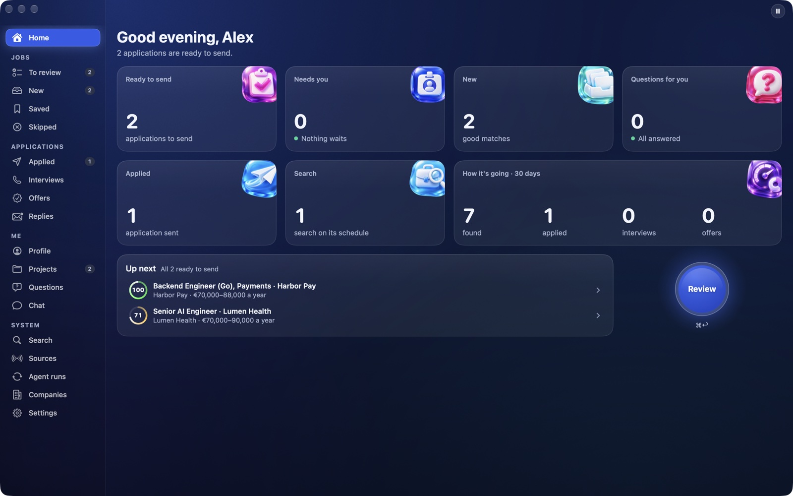
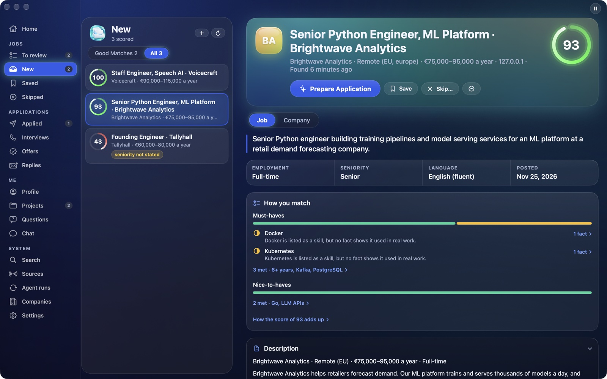
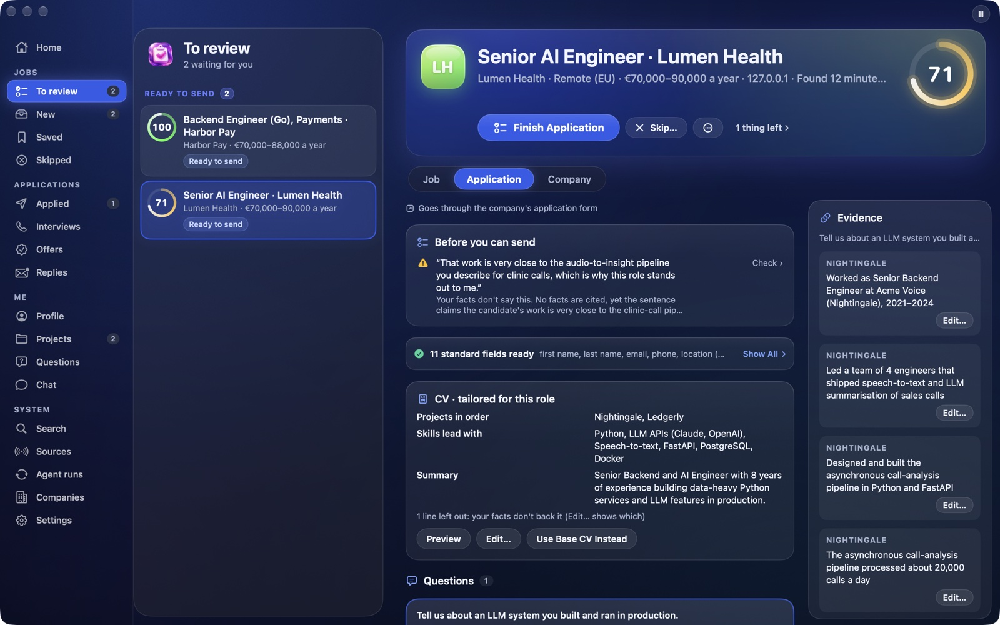
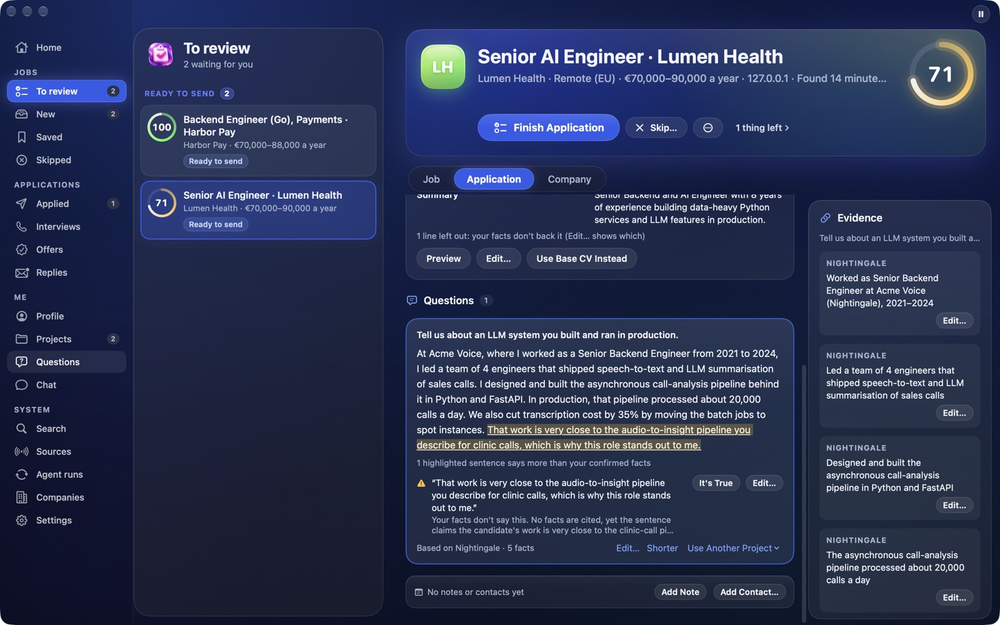
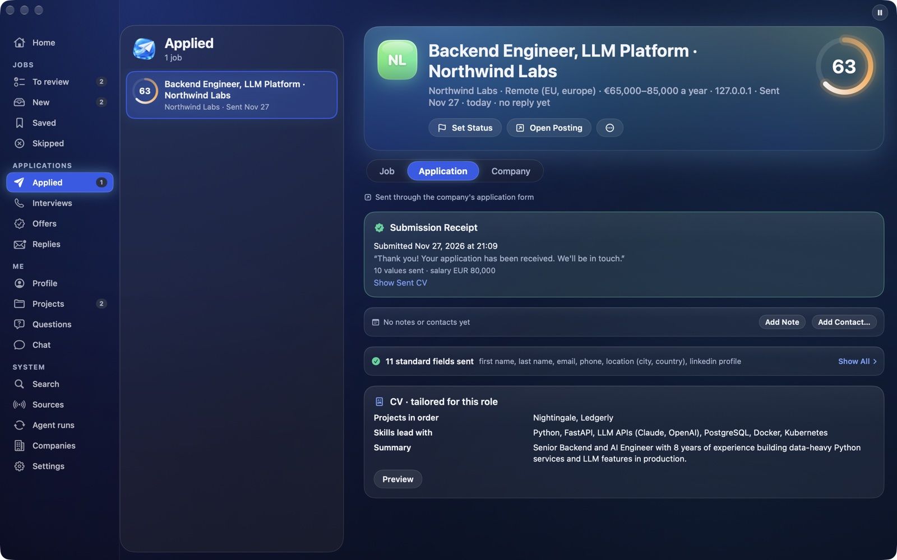
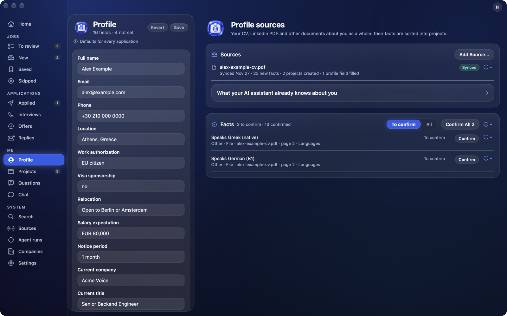

<div align="center">

# Applyant

**A local job-search assistant for macOS.**
It finds postings, scores how well they fit you, and prepares each application from facts you have confirmed.
Nothing is sent until you approve it.

[](https://github.com/romirom11/applyant/actions/workflows/daemon.yml)




</div>

## What it does

| | |
| --- | --- |
| 🔎 **Finds jobs** | Searches job boards, company career pages and the big ATSs (Greenhouse, Ashby, Lever, Workable, SmartRecruiters, Personio and more) on a schedule. |
| 🎯 **Scores the fit** | Every posting gets a score against your preferences and your confirmed experience, with a breakdown of what matches and what doesn't. |
| ✍️ **Prepares applications** | Reads the application form, fills it from your profile, tailors a CV and drafts answers and cover letters. Every sentence points to the facts it rests on. |
| ✅ **Waits for you** | You review every field, answer and the CV before **Approve and Send…**. Claims your facts don't support are flagged and block sending. |
| 📬 **Tracks what happens next** | Keeps a receipt of every submission and follows applications through interviews and offers, including replies from your mailbox. |

Everything runs on your Mac. Your profile, applications and history stay in a local database; secrets go to the macOS Keychain. The AI work runs through the Claude Code CLI on your own subscription, with Codex as an option.

## A look inside

<table>
  <tr>
    <td width="50%">
      
      <p align="center"><b>How you match.</b> A score for each posting, with every requirement checked against your facts.</p>
    </td>
    <td width="50%">
      
      <p align="center"><b>Review before sending.</b> Fields, tailored CV, and what still needs you.</p>
    </td>
  </tr>
  <tr>
    <td width="50%">
      
      <p align="center"><b>Answers you can trust.</b> A sentence your facts don't back is highlighted until you fix or confirm it.</p>
    </td>
    <td width="50%">
      
      <p align="center"><b>A receipt for every send.</b> When it went, what was sent, and the exact CV.</p>
    </td>
  </tr>
</table>

<sub>Screenshots show a demo profile ("Alex Example") and made-up companies served from a local test board.</sub>

## Install

You need a Mac with **Apple silicon** and **macOS 15** or newer, plus:

- **Xcode** (to build the app)
- **Node.js 24** and **pnpm**
- **Claude Code CLI**, signed in. It is required: it reads your CV, scores postings and writes answers.
- *Optional:* **Codex CLI**, signed in. It plans searches and researches companies, and can take over other tasks; without it those two are skipped. **GitHub CLI** (`gh`), signed in, lets Applyant read your repositories.

Then build and install:

```sh
git clone https://github.com/romirom11/applyant.git
cd applyant
scripts/bundle.sh
```

`bundle.sh` builds the app, signs it for this Mac, installs it as `/Applications/Applyant.app`, links the `applyant` CLI into `~/.local/bin` and opens the app. On first launch the app starts its background service and walks you through setup. To check that everything is connected:

```sh
applyant status
```

> The build is signed only for the Mac it was built on and is not notarized, so it is not meant to be copied to other machines.

## Getting started

The setup that opens on first launch covers the same steps:

1. **Connections.** Applyant checks that Claude Code is signed in. Codex, a GitHub login, a mailbox and other services are optional and can be added later in **Settings**.
2. **Import.** Choose your CV. Applyant keeps a local copy, fills your **Profile** from it and extracts facts about your experience. Add projects, repositories, documents or links under **Profile** and **Projects** to give it more to work with.
3. **Confirm your facts.** Applications only rely on facts you have confirmed. Confirm, edit or reject them under **Profile** and **Projects**.
4. **Preferences.** Set target roles, seniority, location, remote, salary, languages and dealbreakers. Change them later in **Settings → General → Edit Preferences…**.

After that, searches start on their own. You can edit them in **Search** and choose where they look in **Sources**.

<p align="center">
  
</p>

## Everyday use

**Jobs**

- **New** lists scored postings without an application. Open one to see the fit breakdown, then choose **Prepare Application**, **Save** (saving prepares it too) or **Skip…**.
- **To review** holds prepared applications: **Needs you**, **Ready to send** and **Preparing**. Check the destination, every field, each drafted answer with its cited facts, the CV and any blockers, then press **Approve and Send…** (⌘↩).
- **Skip…** means a job isn't for you, including when its link only opens a company homepage. Add a short reason if you like: it teaches the scoring. Skipped jobs go to **Skipped** and come back with **Back to New**.

**Applications**

- **Applied**, **Interviews** and **Offers** follow applications after they are sent. Use **Set Status** to record a rejection, an interview or an offer yourself.
- **Replies** shows emails from a connected mailbox (Gmail or IMAP, in **Settings → Connections**) and which application each belongs to.

**Me**

- **Questions for you** collects what Applyant needs to know to finish an application. Your answers are saved as facts and reused next time the same question comes up.
- **Chat** answers questions about your own experience from your profile and confirmed facts, and shows which facts it used.

### CV and cover letter

When a form asks for a CV, Applyant builds a tailored PDF from your confirmed facts. The **CV** card shows which projects and skills lead and what was left out. **Preview** opens it, **Edit…** changes it, and **Use Base CV Instead** sends the CV from your profile for that one application. With too few confirmed facts, Applyant falls back to your base CV.

If the form has a cover letter field, Applyant drafts a letter for that role. Text fields get text, file fields get a PDF. No separate letter is made when the form doesn't ask for one.

### Sending

**Approve and Send…** is available only once every required value, fact and flagged claim is resolved. Applyant then fills the form with exactly what you reviewed. A captcha, a sign-in or an unclear result stops delivery and hands it to you; Applyant never submits twice just because the outcome was uncertain.

Djinni, LinkedIn and Xing apply from your signed-in account. Sign in once in **Settings → Sites → Sign In to a Site…**. Applyant never presses "Log in with Google/GitHub" for you: if a site shows a sign-in page instead of its form, nothing is sent and the application waits under **Needs you**.

After a confirmed submission, the **Submission Receipt** shows when it was sent, how many values went out, the site's confirmation message and the exact CV file.

### Models

In **Settings → Models & Keys** you choose a provider and model for each task (scoring, writing, reading forms and so on): Claude or Codex where both are supported. Small, cheap decisions can go to Jev, and the on-device model can classify replies. Changes apply from the next run.

## Command line

The app covers everyday use. The `applyant` CLI talks to the same background service and is handy for inspecting things in detail:

```sh
applyant status                                   # service and agent CLIs
applyant pause | resume                           # stop or restart background work
applyant candidate show                           # profile, projects, sources
applyant candidate fact list profile              # facts and whether they are confirmed
applyant jobs list --by-score                     # postings, best first
applyant jobs show POSTING_ID
applyant jobs skip POSTING_ID --reason "on-site only"
applyant applications list
applyant applications preview APPLICATION_ID      # what the review screen shows
applyant search strategies list
applyant search sources list
applyant config roles set application_writer codex:MODEL_ID
```

Replace the uppercase IDs with real ones. `applyant --help` and `applyant SECTION --help` list everything else.

## Where your data lives

| What | Where |
| --- | --- |
| Database, CVs, files | `~/Library/Application Support/Applyant` |
| Passwords and keys | macOS Keychain |
| Logs | `~/Library/Logs/Applyant` |

## Development

| Path | What's there |
| --- | --- |
| `app/` | SwiftUI app (menu bar app, main window, Share extension) and its shared logic |
| `daemon/` | TypeScript background service: search, scoring, agents, form filling, database, CLI |
| `native/` | Swift helper for the Keychain, PDF text and system events |
| `proto/` | The API between the app, the CLI and the service |
| `scripts/` | App bundling and a smoke test of the built bundle |
| `docs/design/` | Product and technical design documents |

```sh
pnpm -C daemon install
pnpm -C daemon typecheck
pnpm -C daemon lint
pnpm -C daemon test
swift test --package-path app
swift test --package-path native
scripts/bundle.sh --no-install
```

Some browser tests need Playwright's Chromium: `pnpm -C daemon exec playwright install --only-shell chromium`. On Linux, headed delivery tests need a display such as `xvfb`.

To try the whole loop without applying anywhere real, `node daemon/scripts/demo-board.ts` serves a few synthetic postings on `127.0.0.1:4400` that accept applications and log what arrives. The built app can also be driven by a script for checks and screenshots: `Applyant --script steps.json --out dir/` (see `app/Sources/Applyant/ScriptRunner.swift`).
